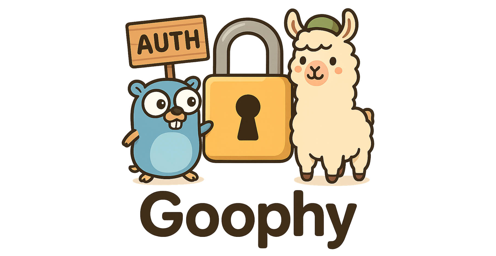

# Ollama Proxy

A simple proxy server for Ollama that adds authentication to requests.



## Overview

This proxy server forwards all requests to an upstream LLM API while adding an `Authorization: Bearer` token header for authentication. It preserves original request methods, headers, and bodies, and works with **Ollama, vLLM, Open WebUI, and other OpenAI-compatible servers** — auto-detecting the upstream at startup and adapting its behavior (see [Supported upstreams](#supported-upstreams)).

## Configuration

The proxy can be configured with environment variables or, equivalently, with
command-line flags. Each option supports **both syntaxes** — when a flag and its
environment variable are both set, the flag wins.

| Env variable            | Flag (`serve`)    | Default                  | Description                                       |
| ----------------------- | ----------------- | ------------------------ | ------------------------------------------------- |
| `HOST`                  | `--host`          | `127.0.0.1`              | Interface to bind to (`--listen-all` = `0.0.0.0`) |
| `PORT`                  | `--port`          | `22434`                  | Port to run the proxy server on                   |
| `API_ENDPOINT`          | `--api-endpoint`  | `http://localhost:11434` | Target API endpoint to forward requests to        |
| `API_KEY`               | `--api-key`       | _(empty)_                | API key used for authentication                   |
| `GOOPHY_ALLOWED_ORIGINS` |               | _(empty)_                | Comma-separated web origins that may call goophy while it adds a key (see [Browsers](#browsers)) |
| `DISABLE_AUTO_UPDATE`   | —                 | `false`                  | Disable auto-update                               |
| `UPDATE_CHECK_INTERVAL` | —                 | `24h`                    | How often to check for updates                    |

> **Deprecated:** `OLLAMA_ENDPOINT` / `--ollama-endpoint` still work as aliases
> for `API_ENDPOINT` / `--api-endpoint`, but print a warning. Prefer the new
> names; the aliases may be removed in a future release.

Configuration can be provided in multiple ways:

1. Command-line flags: `goophy serve --port 22434 --api-endpoint http://localhost:11434 --api-key sk-...`
   (the `--flag=value` form works too, e.g. `--port=22434`)
2. Environment variables: `PORT=22434 API_ENDPOINT=http://localhost:11434 goophy serve`
3. From a `.env` file in the current directory (automatically loaded)
4. From a custom env file specified with the `--env-file` flag: `goophy --env-file my-config.env serve`

Flags and `--env-file` may be placed **before or after** the command — `goophy serve --env-file my-config.env`
and `goophy --env-file my-config.env serve` are equivalent.

See `example.env` for a sample configuration file format.

## The NHN LLM gateway

goophy can sign you in to the LLM gateway and proxy to it with your own token:

```bash
goophy login     # opens the browser; approve, and you are signed in
goophy serve     # no API_ENDPOINT/API_KEY needed: proxies to the gateway as you
goophy usage     # what you have used the last 30 days (--days N)
goophy logout    # revokes the token and forgets it
```

`goophy login` opens `https://gw.chat.nhn.no` (override with `--gateway` or
`GOOPHY_GATEWAY`). When no browser can be opened (over SSH, or with
`--no-browser`) it prints a link to open on any machine, and asks for the code
that page shows. The login expires after 7 days unused, and 30 days after you
logged in at the latest; it is listed under Tokens in the gateway's web
interface. An explicit `API_ENDPOINT` or `API_KEY` always wins
over the login.

A running `goophy serve` follows `goophy login` and `goophy logout` from other
shells: after a new login it uses the new token, and while logged out it
answers `401` with a message saying to run `goophy login`. The token is stored
in `credentials.json`, readable only by you, in `~/Library/Application
Support/goophy` (macOS), `~/.config/goophy` (Linux) or
`%LocalAppData%\goophy` (Windows; kept out of the roaming profile so it does
not follow you to other PCs).

### Browsers

While goophy adds a key (`API_KEY` or the login), web pages could otherwise
spend it through `http://127.0.0.1:22434`. So goophy then serves browser
requests only from pages on `localhost` and the origins listed in
`GOOPHY_ALLOWED_ORIGINS` (e.g. `https://app.example`, or `*` for any), and on
a loopback address only answers to `localhost`-style `Host` names (and
`host.docker.internal`), which blocks DNS rebinding. Programs such as curl,
SDKs and editors send no `Origin` and are not affected. Without a key, any
origin is allowed, as before.

## Supported upstreams

goophy is not Ollama-only. At startup it probes `API_ENDPOINT` to identify the
upstream flavor and self-configures accordingly, so you can point it at any of
these with just a host (no need to hand-write the `/v1` or `/api` path):

| Upstream                    | Detected via                                   | OpenAI path prefix | Auto-pull |
| --------------------------- | ---------------------------------------------- | ------------------ | --------- |
| **Ollama**                  | `GET /` returns `Ollama is running`, `/api/tags` | `/v1`              | ✅ enabled |
| **vLLM**                    | `/v1/models` with `owned_by: "vllm"` / uvicorn | `/v1`              | ❌ disabled |
| **Open WebUI**              | `/api/config`, `/health` → `{"status":true}`   | `/api`             | ❌ disabled |
| **Other OpenAI-compatible** | `/v1/models`                                   | `/v1`              | ❌ disabled |

What "self-configures" means:

- **Automatic path routing.** OpenAI-style requests (`/chat/completions`,
  `/completions`, `/embeddings`, `/rerank`, `/models`) are rewritten to the prefix
  the upstream expects — `/api/...` for Open WebUI, `/v1/...` for vLLM/Ollama. So a
  client sending `POST /chat/completions` reaches `…/api/chat/completions` on Open
  WebUI and `…/v1/chat/completions` on vLLM. Already-prefixed paths and
  Ollama-native paths (`/api/chat`, `/api/generate`, the `/ollama` prefix) are
  passed through unchanged.
- **Auto-pull only where it applies.** The retry-and-`/api/pull` on a missing model
  is kept for Ollama and skipped for vLLM, Open WebUI (which only exposes pulling
  under `/ollama/api/pull`) and generic OpenAI servers.
- **Non-fatal startup.** If the upstream isn't reachable yet, goophy warns and
  starts anyway, forwarding requests once it comes up. Detection is retried on
  incoming requests (at most every 30s) until the upstream answers, so routing
  and auto-pull adapt once it's up. Startup only fails if *every* probe is
  rejected with 401/403.

Detection is logged on startup, e.g.:

```
Detected upstream: vLLM (/v1/models responded 200, Server: uvicorn)
Auto-pull disabled: vLLM upstreams don't support /api/pull
```

Run with `VERBOSE=true` to also log each path rewrite
(`Routed /chat/completions -> /api/chat/completions for Open WebUI upstream`).

## Dashboard

When `goophy serve` runs in an interactive terminal it shows a live dashboard
instead of streaming logs. Switch tabs with `1`–`5`, `Tab` or the arrow keys;
`q` quits and prints a short session summary.

| Tab           | Shows                                                                     |
| ------------- | ------------------------------------------------------------------------- |
| **Dashboard** | Requests, errors, prompt/completion tokens, live tok/s, in-flight streams |
| **Usage**     | Session token totals (incl. prompt-cache hits when reported), tokens per minute, usage by client (User-Agent) and the largest prompts |
| **Requests**  | Every request with status, model, time to first byte, duration and tokens; `Enter` toggles details (path before/after routing, client) |
| **Models**    | Per-model requests, tokens, average time to first byte and tok/s          |
| **Logs**      | The usual log output, scrollable, with `/` to filter                      |

Statistics are kept in memory for the session only. Token counts come from the
upstream's `usage` (OpenAI) or `prompt_eval_count`/`eval_count` (Ollama). To get
them for streamed OpenAI-style requests, goophy adds
`stream_options: {"include_usage": true}` when the client didn't set
`stream_options`, and lets its own HTTP client negotiate compression with the
upstream for generation endpoints. When usage isn't reported, output tokens are
estimated from streamed chunks and shown with a `~`.

The dashboard is skipped — and goophy prints logs exactly as before, with none
of the above request changes — when stdin/stdout isn't a terminal (Docker,
systemd/launchd, piped output), with `--no-tui`, or with `NO_TUI=true`.

## Usage

### Get Started

#### 1. Download the binaries from releases

[https://github.com/NorskHelsenett/goophy/releases](https://github.com/NorskHelsenett/goophy/releases)

#### 2. Docker

Create a `.env` file with the following content:

```.env
API_ENDPOINT="https://openwebui.com/ollama"
API_KEY="sk-your-key-from-OWUI"
```
Then run the following container:

```bash
 docker run --rm --env-file .env -p 22434:22434 ghcr.io/norskhelsenett/goophy serve
````

### Building and Running

```bash
# Build the application
go build -o goophy cmd/goophy/main.go

# Or with custom version
go build -ldflags="-X main.version=0.1.3" -o goophy ./cmd/goophy/

# Run the proxy with default settings
./goophy serve

# Run with custom settings using flags
./goophy serve --port 22434 --api-endpoint https://my-api-server.example.com/v1 --api-key my-secret-key

# ...or the equivalent environment variables
PORT=22434 API_ENDPOINT=https://my-api-server.example.com/v1 API_KEY=my-secret-key ./goophy serve

# Run with settings from a config file (flag works before or after the command)
./goophy --env-file my-config.env serve
./goophy serve --env-file my-config.env

# A .env file in the current directory is automatically loaded
# echo "API_KEY=my-secret-key" > .env
# ./goophy serve
```

### Docker

You can also build and run this proxy in Docker:

```bash
# Build the Docker image
docker build -t ollama-proxy .

# Run the container
docker run -p 22434:22434 -e API_ENDPOINT=https://my-api-server.example.com/v1 -e API_KEY=my-secret-key ollama-proxy
```

### OpenWebUI

OpenWebUI is accessible at the `/ollama` endpoint, so using it would be like `example.com/ollama`.

### Multi-platform Builds

This application is built for multiple platforms:
- macOS (Intel/AMD64 and Apple Silicon/ARM64)
- Linux (AMD64 and ARM64)
- Windows (AMD64 and ARM64)

You can download the latest release from the [releases page](https://github.com/goophy/goophy/releases).

> To run this on MacOSX due to Gatekeeper, you have to add this binary to the allowlist by running `xattr -d com.apple.quarantine ~/.local/bin/goophy`

### Tips

```bash
echo 'export OLLAMA_HOST="http://localhost:22434"' >> .zshrc
```

By exporting the `OLLAMA_HOST` environment its possible to use `ollama ps|run|pull|rm...` without specifying this environment for every request.

### Auto-Update System

The application includes an automatic update feature that:

1. Checks for new versions on GitHub when the application starts
2. Performs periodic checks every 24 hours
3. Automatically downloads and applies updates in the background

The auto-update system will handle the different archive formats for each platform:
- `.tar.gz` for macOS and Linux
- `.zip` for Windows

To disable auto-updates, set the environment variable:
```bash
DISABLE_AUTO_UPDATE=true ./goophy
```

You can also customize the update check interval:
```bash
UPDATE_CHECK_INTERVAL=12h ./goophy
```

## API Endpoints

This proxy supports all Ollama API endpoints by forwarding requests to the target Ollama server. Check the [Ollama documentation](https://github.com/ollama/ollama) for a complete list of API endpoints.

Common endpoints include:

- `/api/generate` - Generate text from a prompt
- `/api/chat` - Chat with a model
- `/api/embeddings` - Get embeddings for a text
- `/api/models` - List available models (OpenAI-compatible)

## Example

```bash
# Call the proxy to chat with a model
curl -X POST http://localhost:22434/api/chat -d '{
  "model": "llama3.2",
  "messages": [{"role": "user", "content": "Hello, how are you?"}]
}'
```

The proxy will forward this request to your Ollama endpoint with the added authentication header and return the response.
